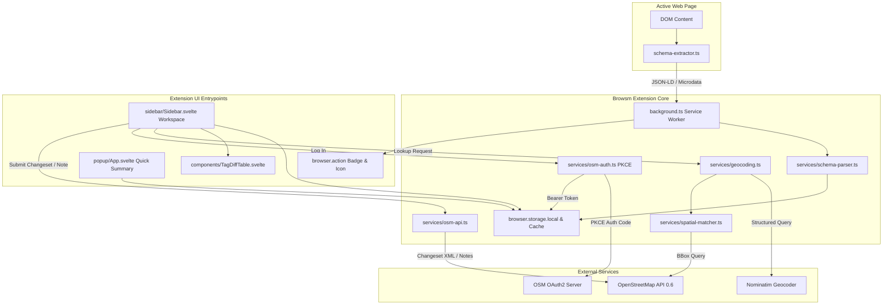

# Requirements

### Overview & Goals
The objective is to elevate `browsm` from an experimental prototype into a robust, high-utility browser extension for OpenStreetMap contributors and local web mappers. The extension maximizes the efficiency of map editing by allowing users to detect, verify, compare, and update Point of Interest (POI) data directly from business and organization websites without context switching or manual copy-pasting.

### Detailed Analysis of Core Questions

#### 1. Testing Framework Strategy: Playwright vs. Cypress vs. Vitest
- **E2E Browser Extension Testing**: `Playwright` is strongly recommended over Cypress.
  - **Why Playwright**: Playwright natively supports launching persistent Chromium browser contexts with unpacked WebExtensions loaded (`--disable-extensions-except` and `--load-extension`). It allows direct inspection of Manifest V3 background service workers (`context.serviceWorkers()`), extension popup/sidepanel pages (`chrome-extension://<id>/...`), and content scripts across real web pages.
  - **Why Cypress is Unsuitable**: Cypress executes tests inside an application iframe within its own test runner page. It lacks first-class capabilities for browser context menus, service worker lifecycle inspection, cross-origin permissions, and side panel APIs.
  - **Unit & Component Testing**: `Vitest` paired with `wxt/testing` (`fakeBrowser`) and `@testing-library/svelte` provides instant feedback for business logic, schema parsing, tag transformation, and Svelte 5 component state.

#### 2. Verification Strategy: Avoiding Nominatim / Overpass Limitations
- **Nominatim Constraints**: Nominatim's public API is subject to strict Acceptable Use Policies (1 request/second, mandatory User-Agent, no bulk scraping). Furthermore, free-form geocoding often returns street or city centroids when a specific business node is missing, leading to false negatives or misleading matches.
- **Recommended Multi-Tiered Verification Pipeline**:
  - **Tier 0 (Direct Extraction)**: If structured data (Schema.org `geo.latitude`/`longitude` or embedded map URLs) exists on the page, bypass geocoding entirely and use exact coordinates.
  - **Tier 1 (Cached Structured Geocoding)**: When coordinates are missing, execute structured Nominatim queries (`street`, `city`, `postalcode`, `country`) rather than raw string search. Results are cached in `browser.storage.local` with a 24-hour time-to-live (TTL).
  - **Tier 2 (Micro-Bounding Box Spatial Inspection)**: Using resolved coordinates, fetch all elements in a 50-meter bounding box via `GET https://api.openstreetmap.org/api/0.6/map?bbox=...` or Overpass. This returns real-time OSM nodes/ways without replication delay, allowing the extension to detect whether the business is already mapped under a slightly different name, has outdated tags (phone/website/hours), or is completely absent.

#### 3. Structured Schema.org & Microdata Extraction and Visual Cues
- **Extraction Scope**: Content scripts scan `<script type="application/ld+json">`, HTML5 Microdata (`itemscope itemtype="https://schema.org/LocalBusiness"`), OpenGraph/meta tags, and heuristic links (`tel:`, `mailto:`, map iframes).
- **Visual Cues & User Indication**:
  - **Action Badge**: Set high-contrast badge text (`"POI"` or count `"1"`) with green background (`#2E7D32`) via `browser.action.setBadgeText`.
  - **Dynamic Icon**: Toggle action icon to active state (`icon-success_1024.png`).
  - **Action Tooltip**: Dynamically set title via `browser.action.setTitle({ title: "Browsm: Found [Business Name] (Click to inspect in OSM)" })`.
  - **Optional In-Page Pill**: Configurable unobtrusive floating toast in the bottom corner of detected business pages.

#### 4. OSM OAuth 2.0 PKCE, Key Management, and API Capabilities
- **Zero-Server PKCE Architecture**:
  - An intermediate secret-holding proxy server is **not** required.
  - OpenStreetMap OAuth 2.0 supports Public Clients with **Proof Key for Code Exchange (PKCE, RFC 7636)**.
  - The extension generates a cryptographically random `code_verifier` and SHA-256 `code_challenge`, opens `https://www.openstreetmap.org/oauth2/authorize` via `browser.identity.launchWebAuthFlow`, and exchanges the authorization code for an access token directly with `https://www.openstreetmap.org/oauth2/token`.
- **Capabilities Unlocked by OAuth2**:
  - Direct Changeset Creation (`PUT /api/0.6/changeset/create`) with `created_by=Browsm` and `source=website`.
  - 1-Click POI Node Creation (`PUT /api/0.6/node/create`) and Tag Updates (`PUT /api/0.6/node/<id>`).
  - OSM Map Note Creation (`POST /api/0.6/notes`) for contributors who prefer community review over direct editing.
  - User profile integration (`GET /api/0.6/user/details`) displaying username and changeset statistics in the sidebar header.

#### 5. UI & Interaction Improvements
- **Dual-Surface Model**:
  - **Popup**: Lightweight summary card showing detected page metadata, instant match status, and quick-action buttons.
  - **Sidebar / SidePanel Workspace**: Comprehensive mapper workspace featuring an interactive Leaflet map, POI search/filter bar, and the **Tag Comparison Matrix**.
- **Tag Comparison Matrix**: A 3-column diff view (`Tag` | `Page Data` | `OSM Live Data` | `Action`) enabling selective tag merging, phone/URL normalization, and changeset preview.

#### 6. Code Quality, Reliability, and Cleanup
- **Svelte 5 Runes Refactoring**: Upgrade components from legacy Svelte 4 syntax to modern runes (`$state`, `$derived`, `$effect`, `onclick`).
- **Fix Known Bugs**: Repair typo in `Sidebar.svelte` (`payload.timeYeahstamp`) and eliminate memory leaks by tying Leaflet map initialization and destruction to Svelte 5 `$effect` teardown.
- **Modular Service Architecture**: Deconstruct monolithic files into focused, type-safe modules for geocoding, OSM API interaction, schema parsing, and state management.

### Scope
- **In Scope**:
  - Svelte 5 runes refactoring and TypeScript interface definitions.
  - Vitest unit/integration testing suite and Playwright E2E browser extension testing setup.
  - Content script for JSON-LD, Microdata, and meta tag extraction.
  - Dynamic toolbar badge, tooltip, and icon state updates.
  - Multi-tiered place verification with local caching and bounding-box OSM inspection.
  - OAuth 2.0 PKCE authentication and direct OSM API 0.6 node/changeset/note integration.
  - Redesigned Sidebar with Leaflet map and Tag Comparison Matrix.
  - External editor launch support (iD, Rapid, JOSM Remote Control).
- **Out of Scope**:
  - Complex multipolygon relation editing.
  - Hosting external backend proxy servers.
  - Mobile browser extension adaptations beyond standard Manifest V3 compatibility.

### User Stories
- **Story 1 (Mapper Discovery)**: As an OSM contributor browsing a restaurant's website, I want the extension icon to badge automatically when business metadata is found, so that I immediately know the site has structured data available for mapping.
- **Story 2 (Tag Verification & Diffing)**: As an OSM contributor, I want to open the sidebar and see a side-by-side comparison of webpage tags (phone, opening hours, address) versus live OSM data, so that I can quickly spot discrepancies without manually copying text.
- **Story 3 (Direct Editing via PKCE)**: As an authenticated OSM user, I want to click "Apply Changes" to write updated tags to OpenStreetMap via a dedicated changeset, so that I can improve the map in seconds.
- **Story 4 (Non-Destructive Notes)**: As a casual mapper without full editing confidence, I want to create an OSM Note with the detected business details, so that experienced local mappers can verify and add the data.

# Technical Design

### Current Implementation
- **Entrypoints**:
  - `src/entrypoints/background.ts`: Listens for context menu clicks, makes unauthenticated `fetch` requests to Nominatim, sends OS desktop notifications via `browser.notifications.create`, and relays messages.
  - `src/entrypoints/sidebar/Sidebar.svelte`: Initializes a static Leaflet map, listens for messages, displays raw JSON in a `<pre>` tag, and creates an external tab linking to `openstreetmap.org/edit`.
  - `src/entrypoints/popup/App.svelte`: Default WXT placeholder counter component.
- **Issues Identified**:
  - Typo in `Sidebar.svelte` line 19 (`payload.timeYeahstamp`) causing timestamp synchronization failures.
  - Global Leaflet instance variables without proper teardown, triggering map re-initialization crashes.
  - Lack of structured data extraction from active web pages.
  - Uncached, single-strategy Nominatim queries that fail on POI-specific lookups.
  - Absence of automated unit, integration, or E2E tests.

### Architecture Diagram


### Key Decisions
- **Decision 1: Playwright + Vitest Test Architecture**:
  - *Choice*: Use `vitest` with `wxt/testing` for fast unit tests of parsers and API serializers, and `playwright` for end-to-end browser extension automation.
  - *Rationale*: Playwright provides native browser extension loading and service worker inspection in Chromium, whereas Cypress operates inside an iframe sandbox incapable of native extension testing.
- **Decision 2: Public Client OAuth 2.0 PKCE (RFC 7636)**:
  - *Choice*: Implement client-side PKCE using `browser.identity.launchWebAuthFlow` directly against `https://www.openstreetmap.org/oauth2/`.
  - *Rationale*: Eliminates the security risk, maintenance cost, and latency of running an intermediate secret-holding backend server while adhering to IETF standards for browser applications.
- **Decision 3: Two-Phase Spatial Matching Pipeline**:
  - *Choice*: Use page coordinates first; fall back to cached structured Nominatim geocoding; then inspect a 50m bounding box via OSM API 0.6 (`/api/0.6/map?bbox=...`).
  - *Rationale*: Avoids Nominatim rate limits, prevents road/centroid false matches, and reveals all existing POIs on the parcel for tag comparison.
- **Decision 4: Svelte 5 Modern Runes & Component Lifecycle**:
  - *Choice*: Refactor all state to Svelte 5 runes (`$state`, `$derived`, `$effect`) and encapsulate Leaflet in a dedicated wrapper component with explicit teardown.
  - *Rationale*: Resolves memory leaks, guarantees clean map re-rendering, and provides deterministic reactive state across storage updates.

### Data Models & Contracts

```typescript
// Extracted Webpage Metadata
export interface SchemaOrgPlace {
  name?: string;
  alternateName?: string;
  type: string; // e.g. "Restaurant", "LocalBusiness", "Place"
  address?: {
    streetAddress?: string;
    addressLocality?: string;
    addressRegion?: string;
    postalCode?: string;
    addressCountry?: string;
  };
  geo?: {
    latitude: number;
    longitude: number;
  };
  telephone?: string;
  url?: string;
  openingHours?: string[];
  email?: string;
  sourceUrl: string;
}

// Live OpenStreetMap Element
export interface OsmElement {
  id: number;
  type: 'node' | 'way' | 'relation';
  lat: number;
  lon: number;
  version: number;
  changeset?: number;
  tags: Record<string, string>;
}

// Tag Comparison Item
export interface TagDiffItem {
  key: string;
  pageValue?: string;
  osmValue?: string;
  status: 'match' | 'missing_in_osm' | 'outdated_in_osm' | 'conflict';
  selectedAction: 'copy_to_osm' | 'keep_osm' | 'custom';
  customValue?: string;
}

// Spatial Match Result
export interface SpatialMatchResult {
  matchStatus: 'exact_match' | 'possible_match' | 'no_match';
  targetCoordinates: { lat: number; lon: number };
  matchedElement?: OsmElement;
  nearbyElements: OsmElement[];
  tagDiffs: TagDiffItem[];
}
```

### Proposed Changes & File Structure

```
browsm/
├── .github/workflows/
│   └── test-and-release.yml      # CI workflow for Vitest and Playwright
├── package.json                   # Updated with Vitest, Playwright, dependencies
├── vitest.config.ts               # Vitest + Svelte + WXT test configuration
├── playwright.config.ts           # Playwright Chromium extension test setup
├── src/
│   ├── entrypoints/
│   │   ├── background.ts          # Unified background service worker
│   │   ├── content/
│   │   │   └── schema-extractor.ts# In-page JSON-LD and Microdata extractor
│   │   ├── popup/
│   │   │   ├── App.svelte         # Compact summary popup
│   │   │   ├── index.html
│   │   │   └── main.ts
│   │   └── sidebar/
│   │       ├── Sidebar.svelte     # Full mapper workspace
│   │       ├── index.html
│   │       └── main.ts
│   ├── components/
│   │   ├── LeafletMap.svelte      # Encapsulated Leaflet map with Svelte 5 $effect
│   │   ├── TagDiffTable.svelte    # 3-column tag comparison & merge table
│   │   ├── AuthHeader.svelte      # OSM OAuth login status and user badge
│   │   └── ChangesetModal.svelte  # Changeset comment & upload dialog
│   ├── services/
│   │   ├── schema-parser.ts       # JSON-LD / Microdata parsing & extraction
│   │   ├── tag-normalizer.ts      # Address, phone (E.123), and hours normalizer
│   │   ├── geocoding.ts           # Structured Nominatim client + local cache
│   │   ├── spatial-matcher.ts     # Bounding-box POI retrieval & string comparator
│   │   ├── osm-auth.ts            # OAuth 2.0 PKCE authorization client
│   │   ├── osm-api.ts             # Changeset, node create/update XML client
│   │   └── osm-notes.ts           # OSM Map Notes creation service
│   ├── stores/
│   │   ├── auth.ts                # Svelte 5 reactive auth state
│   │   └── active-tab.ts          # Active tab POI & diff state
│   ├── types/
│   │   ├── schema.ts
│   │   ├── osm.ts
│   │   └── messaging.ts
│   └── lib/
│       └── messaging.ts           # Webext-core messaging definitions
├── tests/
│   ├── unit/                      # Vitest unit tests
│   │   ├── schema-parser.test.ts
│   │   ├── tag-normalizer.test.ts
│   │   ├── geocoding.test.ts
│   │   ├── spatial-matcher.test.ts
│   │   └── osm-auth.test.ts
│   └── e2e/                       # Playwright browser extension tests
│       ├── extension.fixture.ts
│       └── poi-workflow.spec.ts
```

### Risks & Mitigations
- **Risk 1: Accidental Bad Map Edits**: Automated tag syncing might overwrite intentional community tags with marketing copy.
  - *Mitigation*: The extension will **never** perform silent or bulk automatic edits. Every edit requires explicit user confirmation via the Tag Comparison Matrix and changeset comment dialog with clear attribution tags (`source=website; created_by=Browsm <version>`).
- **Risk 2: OAuth 2.0 Token Expiry & Storage Security**: Access tokens stored in extension storage could become invalid or be leaked.
  - *Mitigation*: Tokens are stored strictly in `browser.storage.local` (isolated from webpage scripts), and the client handles `401 Unauthorized` responses gracefully by prompting re-authentication.
- **Risk 3: Dynamic Single Page Applications (SPAs)**: Webpages rendering JSON-LD asynchronously via JavaScript might be missed if extraction runs too early.
  - *Mitigation*: The content script executes at `document_idle` and includes a `MutationObserver` on `<head>` and `<body>` to detect dynamically injected JSON-LD scripts or microdata updates.

# UI & UX Specifications

### UI & UX Design Principles
1. **Zero Distraction While Browsing**: The extension remains silent until local business data is detected, signaling availability via a lightweight toolbar badge rather than intrusive popups or OS notifications.
2. **Side-by-Side Clarity**: Mappers should never have to memorize or manually copy values across tabs. All detected webpage attributes sit directly alongside current OSM data.
3. **Selective Control**: Users can merge individual fields (e.g., update phone number only while leaving existing address unchanged) with a single click.

### Surfaces & Layout

#### 1. Action Popup (Quick Summary)
- Triggered by clicking the toolbar icon.
- **Header**: Business Name and Schema Type Badge (e.g., `Restaurant`, `LocalBusiness`).
- **Body**: Detected address, phone, website, and matching status indicator (`Found in OSM: Node #8123910` or `Not Found in OSM`).
- **Actions**:
  - `Inspect in Sidebar` (Primary action — expands full workspace).
  - `Quick Add Note` (Submits an OSM Note with extracted data).
  - `Copy OSM Tags` (Copies formatted tag lines to clipboard).

#### 2. Sidebar Workspace (Full Mapper Panel)
- **Header Section**:
  - Active webpage title & URL.
  - User Authentication Banner: Shows avatar, OSM username, and logout button, or a "Log in with OSM" button.
  - Manual search / address input for overrides.
- **Map Section (Leaflet Component)**:
  - Responsive height (300px - 450px) with layer controls.
  - **Markers**:
    - Blue Pin: Extracted Webpage Coordinates.
    - Green Pin: Selected/Matched OSM POI.
    - Orange Pins: Other nearby POIs within 50m.
  - Crosshair tool allowing mappers to fine-tune the POI coordinate by clicking on the map.
- **Tag Comparison Matrix (Core Component)**:
  - Table columns: `OSM Key` | `Page Value` | `Current OSM Value` | `Diff / Action`.
  - Rows for `name`, `amenity`/`shop`, `addr:housenumber`, `addr:street`, `addr:postcode`, `addr:city`, `phone`, `website`, `opening_hours`.
  - Visual status chips:
    - Green: `Identical`
    - Yellow: `Missing in OSM` (offers `+ Copy`)
    - Blue: `Different / Outdated` (offers `⇄ Replace`)
  - Inline editable fields allowing manual corrections before upload.
- **Footer Action Bar**:
  - Primary Button: `Upload Changeset to OSM` (opens modal with changeset comment).
  - Secondary Button: `Create Map Note`.
  - External Launchers: Dropdown menu for `Open in iD`, `Open in Rapid`, `Open in JOSM (Remote Control)`.

### Accessibility & Theming
- Fully responsive layout adhering to WCAG 2.1 AA standards.
- High-contrast text, clear focus rings on all interactive controls, and full keyboard navigation across the Tag Diff table.
- Automatic light/dark mode adaptation matching browser preferences.

# Testing Strategy

### Validation Approach
A dual-layer testing strategy combines fast, deterministic unit/integration tests with end-to-end browser automation:
1. **Unit & Integration Layer (Vitest + `wxt/testing`)**:
   - Tests schema extraction algorithms against diverse JSON-LD, Microdata, and OpenGraph HTML fixtures.
   - Verifies address normalization, phone number E.123 formatting, and opening hours conversion.
   - Tests OAuth 2.0 PKCE challenge generation, XML changeset serialization, and error handlers with mocked HTTP responses.
2. **End-to-End Layer (Playwright)**:
   - Launches Chromium with the unpacked extension.
   - Navigates to local test web fixtures containing embedded Schema.org markup.
   - Verifies that toolbar badges update, the sidebar opens, Leaflet map renders correct coordinates, and tag diff items match expected values.

### Key Test Scenarios

#### Scenario 1: JSON-LD Schema Extraction & Badging
- **Input**: Navigate to a mock restaurant page with `<script type="application/ld+json">` containing address, phone, and geo coordinates.
- **Expected Outcome**:
  - Content script parses `LocalBusiness` data and messages background worker.
  - Extension action badge updates to `"POI"` with `#2E7D32` background color.
  - Action title updates with the business name.

#### Scenario 2: Two-Phase Place Verification & Tag Comparison
- **Input**: Open sidebar on a page where the business exists in OSM but has an outdated phone number and missing website.
- **Expected Outcome**:
  - Spatial matcher queries bounding box and identifies the existing OSM node.
  - Tag Comparison Matrix displays `phone` with status `Different / Outdated` and `website` with `Missing in OSM`.
  - Clicking `Replace` updates the staged changeset payload.

#### Scenario 3: OAuth 2.0 PKCE Authentication & Changeset Upload
- **Input**: User clicks "Log in with OSM", completes mocked OAuth redirect flow, and clicks "Upload Changeset".
- **Expected Outcome**:
  - PKCE tokens are exchanged and securely stored in `browser.storage.local`.
  - An OSM Changeset is opened (`PUT /api/0.6/changeset/create`), the node is updated (`PUT /api/0.6/node/<id>`), and the changeset is closed (`PUT /api/0.6/changeset/<id>/close`).
  - Success message displays the new changeset ID with a direct link to `openstreetmap.org/changeset/<id>`.

#### Scenario 4: Non-Destructive OSM Note Fallback
- **Input**: User clicks "Create Map Note" on an unmapped location.
- **Expected Outcome**:
  - Extension sends `POST /api/0.6/notes` with lat, lon, and text describing the business.
  - Sidebar displays confirmation with link to the created note.

### Test Fixtures & Mocking Strategy
- **HTML Fixtures**: Stored in `tests/fixtures/pages/` containing sample JSON-LD blocks (nested `@graph`, Microdata tables, malformed markup, missing coordinates).
- **API Mocks**: MSW (Mock Service Worker) or native fetch intercepts for Nominatim geocoding and OSM API 0.6 endpoints.

# Delivery Steps

###   Step 1: Codebase Stabilization, Svelte 5 Runes Refactoring, and Vitest Unit Testing Setup
The Browsm codebase is refactored to standard Svelte 5 runes, TypeScript types are enforced across all modules, and Vitest with WXT test helpers is configured and passing.

- Fix existing bugs and typos in `src/entrypoints/sidebar/Sidebar.svelte` (such as `payload.timeYeahstamp`) and eliminate module-level Leaflet map memory leaks by introducing a clean Svelte 5 component lifecycle with `$effect`.
- Refactor Svelte components from legacy Svelte 4 event directives (`on:click`) to Svelte 5 runes (`$state`, `$derived`, `$effect`, `onclick`).
- Define strict TypeScript interfaces and data models in `src/types/` for `NominatimResult`, `OsmElement`, `OsmChangeset`, `SchemaOrgPlace`, and `TagDiff`.
- Clean up `wxt.config.ts` manifest permissions, removing redundant `declarativeNetRequest` rules and standardizing permissions for storage, activeTab, and scripting.
- Install and configure `vitest`, `@testing-library/svelte`, `jsdom`, and `wxt/testing` in `package.json` and `vitest.config.ts`.
- Write unit tests in `tests/unit/` covering storage utilities, messaging contracts, and basic Svelte component rendering.

###   Step 2: In-Page Structured Data (Schema.org / Microdata) Extraction & Dynamic Icon/Badge State
The extension extracts JSON-LD and Microdata POI information from visited web pages and proactively highlights the extension icon and toolbar badge when valid local business data is found.

- Create a content script in `src/entrypoints/content/schema-extractor.ts` registered in `wxt.config.ts` to run at `document_idle`.
- Implement JSON-LD and HTML5 Microdata parsing logic in `src/services/schema-parser.ts` to extract `LocalBusiness`, `Place`, `Organization`, `Restaurant`, `Store`, addresses, phone numbers, opening hours, and geo coordinates.
- Implement tag normalization utilities in `src/services/tag-normalizer.ts` to convert extracted web data into valid OpenStreetMap tag conventions (`addr:street`, `addr:housenumber`, `phone` in E.123 format, `opening_hours`, `website`).
- Update `src/entrypoints/background.ts` to listen for schema detection messages from content scripts, manage tab-specific state, and update `browser.action.setBadgeText`, `browser.action.setBadgeBackgroundColor`, and `browser.action.setIcon`.
- Add unit tests in `tests/unit/schema-parser.test.ts` with diverse HTML and JSON-LD fixture examples testing edge cases (arrays, nested `@graph`, missing fields).

###   Step 3: Multi-Tiered Geocoding & Bounding-Box Spatial Matcher
The extension performs intelligent two-phase place verification using local caching, direct coordinate inspection, and bounding-box OSM element matching to minimize rate limits and maximize match accuracy.

- Implement a geocoding service in `src/services/geocoding.ts` with structured Nominatim query generation, user-agent enforcement, and local storage caching (`browser.storage.local`) with a 24-hour TTL.
- Implement a spatial place verification service in `src/services/spatial-matcher.ts` that retrieves all POIs within a 50-meter bounding box using `https://api.openstreetmap.org/api/0.6/map?bbox=...` or Overpass API.
- Implement a string and spatial comparison engine in `src/services/comparator.ts` that scores existing OSM elements against extracted webpage metadata (name similarity, phone match, website match, exact coordinates).
- Connect background context menu actions (`"Check Address in OSM"`) and toolbar clicks to the multi-tiered verification pipeline, emitting structured `TagDiff` payloads to the sidebar.
- Add unit and integration tests in `tests/unit/spatial-matcher.test.ts` verifying geocoding caching, bounding-box parsing, and similarity scoring.

###   Step 4: OSM OAuth 2.0 PKCE Client & Changeset / Note Submission Service
Users can authenticate directly with OpenStreetMap via OAuth 2.0 PKCE without intermediate servers, enabling direct POI creation, tag updates, and OSM Note submissions.

- Implement an OAuth 2.0 PKCE authentication service in `src/services/osm-auth.ts` utilizing `browser.identity.launchWebAuthFlow` with SHA-256 `code_challenge` and `code_verifier` (RFC 7636).
- Implement an OSM API client in `src/services/osm-api.ts` to handle user details retrieval (`/api/0.6/user/details`), changeset creation (`/api/0.6/changeset/create`), node creation/modification (`/api/0.6/node/*`), and changeset closure (`/api/0.6/changeset/*/close`).
- Implement an OSM Note creation fallback in `src/services/osm-notes.ts` (`POST /api/0.6/notes`) for users who wish to report missing or outdated data without performing direct map edits.
- Add authenticated user state storage and token lifecycle management (refresh/expiry handling) in `src/stores/auth.ts`.
- Write unit tests in `tests/unit/osm-auth.test.ts` and `tests/unit/osm-api.test.ts` mocking network responses and verifying PKCE parameter generation, XML payload serialization, and error recovery.

###   Step 5: Redesigned Sidebar UI with Tag Comparison Matrix & Playwright E2E Test Suite
The sidebar and popup interfaces feature a modern tag diff matrix, Leaflet map workspace, and commit dialog, fully verified by Playwright browser extension end-to-end tests.

- Implement a compact Action Popup in `src/entrypoints/popup/App.svelte` displaying extracted webpage metadata, match status summary, and quick-action buttons.
- Redesign `src/entrypoints/sidebar/Sidebar.svelte` into a structured workspace containing: responsive Leaflet map, POI search/filter input, Tag Comparison Matrix component (`src/components/TagDiffTable.svelte`), and changeset commit modal.
- Build the Tag Comparison Matrix with individual tag merge buttons, inline value editing, format validation warnings, and changeset comment inputs.
- Add external editor integration options (opening in iD, Rapid, or JOSM via remote control `http://localhost:8111/load_and_zoom`).
- Set up Playwright in `tests/e2e/` with Chromium extension loading fixtures to verify extension startup, content script schema extraction, sidebar opening, map interaction, and tag diff workflow.
- Update `README.md`, `FEATURES.md`, and generate user and developer documentation in `documentation/`.