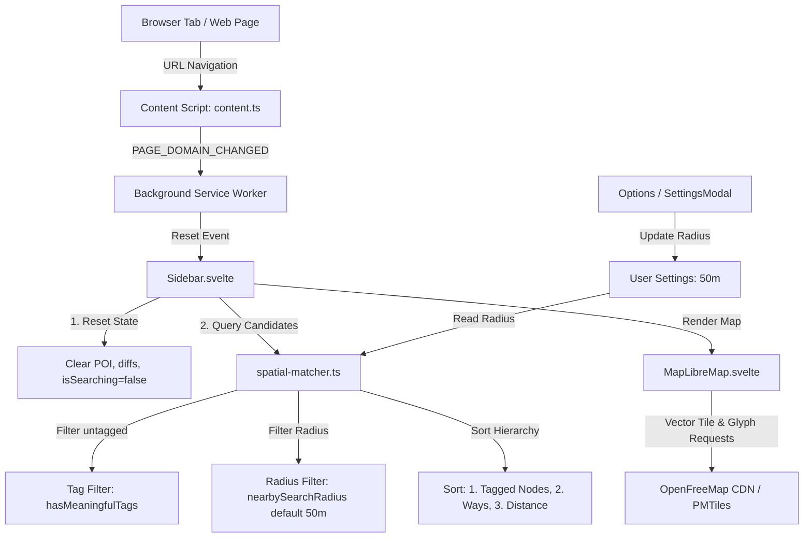

# Requirements

### Overview & Goals
The Browsm extension's sidebar provides an embedded MapLibre GL map, nearby POI discovery, and OSM data editing capabilities. This plan addresses three primary issues:
1. **Map Tile Loading & CSP Restrictions**: Fix MapLibre GL tile, font glyph, and sprite loading failures within the extension environment, and establish headless end-to-end test verification.
2. **Domain Transition & Clean State Management**: Ensure that navigating between website domains clears stale POI and inspection data from the sidebar, and prevent the "Searching..." notice from rendering prematurely on cold start or clean state.
3. **Nearby Places Filtering & Radius Settings**: Filter out untagged OSM nodes and ways from the Nearby Places list, prioritize tagged nodes ahead of ways, and introduce a user-configurable search radius setting (defaulting to 50 meters).

---

### Scope
- **In Scope**:
  - Updating `wxt.config.ts` Content Security Policy (`connect-src`, `font-src`, `style-src`, `worker-src`) and host permissions for OpenFreeMap styles, glyphs, and tiles.
  - Ensuring MapLibre GL CSS is bundled properly for sidebar embedding.
  - Implementing domain navigation change listeners in `src/content/content.ts` and dispatching domain change reset events.
  - Resetting sidebar inspection state, spatial match cache, and search indicators in `src/sidebar/Sidebar.svelte` upon domain change.
  - Fixing initial search loading flags so the searching indicator only renders when a search operation is actively underway.
  - Adding tag filtering in `src/utils/spatial-matcher.ts` to exclude untagged nodes/ways and prioritizing tagged nodes over ways/relations.
  - Adding `nearbySearchRadius` (default: 50m) to user settings schema, storage, `SettingsModal.svelte`, and `Options.svelte`.
  - Creating Playwright E2E headless tests with network interception to verify tile loading and state transitions.
  - Updating `FEATURES.md`, `documentation/`, and generating summary reports adhering to Mozilla Add-on Policies.
- **Out of Scope**:
  - Replacing MapLibre GL with a different mapping library.
  - Modifying OSM changeset submission or OAuth authentication flows.

---

### User Stories
- **As a mapper**, I want to see the OpenFreeMap vector map tiles rendered clearly in the sidebar so that I can inspect the geographical context of the webpage I am visiting.
- **As a user navigating between websites**, I want the sidebar to reset its data when I navigate to a new domain so that I am not looking at mismatched or obsolete POI information from a previous site.
- **As a user opening the sidebar**, I want to see a clear initial state without a perpetual "Searching..." notice unless an actual spatial or address search is running.
- **As a contributor**, I want the Nearby Places list to only show meaningful, tagged POIs (prioritizing points/nodes over large area polygons) within a customizable distance (e.g. 50 meters) so that I can quickly spot relevant features to edit.

---

### Functional Requirements
- **FR-1 (Map Tile Rendering)**: MapLibre GL must fetch vector tiles, style JSONs, sprites, and font glyphs from `https://tiles.openfreemap.org/` (and fallback style endpoints) without Content Security Policy blocking.
- **FR-2 (E2E Tile Test)**: An automated E2E test must load the extension sidebar in a headless environment, intercept or verify tile requests, and assert that the map canvas and tiles load without errors.
- **FR-3 (Domain Reset)**: When the active browser tab navigates to a different hostname/domain, the extension content script / background worker must notify the sidebar to clear previous candidates, selected POIs, diff tables, and inspection results.
- **FR-4 (Initial Search Indicator)**: The sidebar must start with `isSearching = false` (or equivalent scanning indicator) and only toggle the "Searching..." status banner when an active Nominatim or Overpass query is executing.
- **FR-5 (Untagged POI Filter)**: The Nearby Places list must reject OSM nodes, ways, and relations that contain no identifying tags (or only internal OSM metadata tags like `created_by`).
- **FR-6 (Node Prioritization)**: When sorting nearby candidates, tagged `node` elements must be sorted ahead of `way` and `relation` structures, followed by ascending distance from the target coordinate.
- **FR-7 (Configurable Search Radius)**: Settings must include a `nearbySearchRadius` option (number in meters, default: `50`, min: `10`, max: `500`) configurable via both Quick Settings Modal and the Options page.

---

### Non-Functional Requirements
- **Performance**: Spatial distance calculations and tag filtering must execute in under 10ms for datasets up to 500 nearby elements.
- **Mozilla Policy Compliance**: Complies with Manifest V3 CSP standards; no remote script evaluation (`unsafe-eval`), only explicit HTTPS CDN connections to OpenFreeMap and OpenStreetMap APIs.
- **Backward Compatibility**: Preserves all existing settings stored in `chrome.storage.local` with automatic migration / fallback to 50m default radius.

# Technical Design

### Current Implementation
- **Map & CSP**: `MapLibreMap.svelte` uses MapLibre GL with OpenFreeMap styles (`https://tiles.openfreemap.org/styles/liberty`). However, `wxt.config.ts` has a restrictive CSP `extension_pages` string that lacks `font-src`, `style-src 'unsafe-inline'`, and explicit subdomains for OpenFreeMap glyphs/sprites (`https://*.openfreemap.org`, `https://*.openfreemap.com`), leading to blocked font and sprite resources when vector tiles render.
- **Navigation & State**: `src/content/content.ts` scans the page on `DOMContentLoaded` and sends `PAGE_METADATA_EXTRACTED` and `LOCATION_DETECTED`. However, when navigating via SPA client-side routing or cross-domain browsing, no domain transition reset message is broadcast, leaving old POI diffs and comparisons active in `Sidebar.svelte`.
- **Search Notice**: `Sidebar.svelte` initializes or triggers `isSearching = true` before verifying whether address queries or spatial matching are actually executing, showing a flashing or stuck "Searching for POI..." notification.
- **Nearby Places & Tag Matching**: `src/utils/spatial-matcher.ts` ranks structures and nearby nodes based on distance and name overlap, but does not strictly discard nodes/ways that have empty tags (or only internal metadata tags) and does not enforce a node-first prioritization hierarchy.
- **Settings**: `src/types/settings.ts` defines `UserSettings` with `osmServerPreset`, `developerMode`, and `preferredEditor`, but lacks a configurable `nearbySearchRadius` property.

---

### Key Decisions
1. **Decision: CSP Enhancement for OpenFreeMap Assets**
   - *Chosen Approach*: Update `wxt.config.ts` to include `connect-src 'self' https://*.openstreetmap.org https://nominatim.openstreetmap.org https://*.openfreemap.org https://*.openfreemap.com https://*.openhistoricalmap.org; font-src 'self' data: https://*.openfreemap.org https://*.openfreemap.com; style-src 'self' 'unsafe-inline'; worker-src 'self' blob:;`
   - *Rationale*: OpenFreeMap vector styles download PBF glyphs (fonts) and JSON sprites from their CDN in addition to vector tiles. Without `font-src` and `worker-src blob:`, MapLibre GL fails silently or throws WebGL tile decoding errors.

2. **Decision: Navigation Event Hooking & Domain Change Message**
   - *Chosen Approach*: Content script listens for navigation changes (`window.addEventListener('pagehide')`, `popstate`, URL changes via `MutationObserver` or `webNavigation` / tab update listener in background) and sends a `PAGE_DOMAIN_CHANGED` message with the new domain.
   - *Rationale*: Resetting on domain change ensures the user never sees stale POIs from Google Maps when they navigate to a Yelp page or OSM site.

3. **Decision: Tagged-Node First Priority Algorithm**
   - *Chosen Approach*: Filter elements where `Object.keys(tags).filter(k => !k.startsWith('source') && k !== 'created_by').length > 0`. Sort with primary comparator `(a.type === 'node' ? 0 : 1) - (b.type === 'node' ? 0 : 1)` and secondary comparator `distance(a) - distance(b)`.
   - *Rationale*: Point POIs (shops, cafes, amenities) are more precise edit targets than large boundary ways/polygons, which should appear after specific point features.

4. **Decision: Search Radius Setting in Storage**
   - *Chosen Approach*: Add `nearbySearchRadius: number` (default `50`) to `UserSettings` with validation `Math.max(10, Math.min(500, value))`.
   - *Rationale*: Allows users in dense urban settings to narrow search to 25-50m, while rural mappers can expand to 200m+.

---

### Proposed Changes

#### 1. Configuration & CSP (`wxt.config.ts`)
- Update `manifest.content_security_policy.extension_pages` with complete OpenFreeMap font, worker, and connect permissions.
- Ensure host permissions cover OpenFreeMap tile and CDN domains.

#### 2. Map Component & Styles (`src/components/MapLibreMap.svelte`)
- Bundle MapLibre GL CSS or include standard MapLibre styles inside the component to prevent canvas styling glitches.
- Add error handling for style and tile loading with user-visible diagnostics or fallback handling.

#### 3. Content Script & Domain Transition (`src/content/content.ts`, `src/utils/messaging.ts`)
- Implement domain tracking in content script: store current hostname, detect hostname changes on page load/navigation, and send `PAGE_DOMAIN_CHANGED` message.
- Update background listener to forward active tab domain transitions to sidebar.

#### 4. Sidebar State & Search Indicator (`src/sidebar/Sidebar.svelte`)
- Add handler for `PAGE_DOMAIN_CHANGED` that resets `extractedMetadata`, `currentPoi`, `nearbyStructures`, `matchedCandidate`, and sets `isSearching = false`.
- Ensure `isSearching` is only set to `true` when an asynchronous search/query begins, and reset to `false` in `finally` blocks.

#### 5. Spatial Matcher & Tag Filtering (`src/utils/spatial-matcher.ts`)
- Add `hasMeaningfulTags(element: OsmElement): boolean` helper checking for recognized OSM keys (`amenity`, `shop`, `tourism`, `name`, `building`, `craft`, `office`, `leisure`, `historic`, etc.).
- Filter candidates to exclude untagged nodes/ways.
- Sort filtered candidates prioritizing `node` over `way` and `relation`, then by distance.
- Filter candidate structures/nodes by `settings.nearbySearchRadius` (defaulting to 50m).

#### 6. Settings Store & UI (`src/types/settings.ts`, `src/utils/storage.ts`, `src/components/SettingsModal.svelte`, `src/options/Options.svelte`)
- Extend `UserSettings` interface with `nearbySearchRadius: number`.
- Provide number input / slider in `SettingsModal.svelte` and `Options.svelte` for Search Radius (10m - 500m, default 50m).

---

### Data Models / Contracts

```typescript
// src/types/settings.ts
export interface UserSettings {
  osmServerPreset: OsmServerPreset;
  customApiUrl?: string;
  developerMode: DeveloperModeSetting;
  preferredEditor: PreferredEditor;
  customEditorUrl?: string;
  autoExtractMetadata: boolean;
  theme: 'light' | 'dark' | 'system';
  mapStyle: 'liberty' | 'bright' | 'positron' | 'dark';
  nearbySearchRadius: number; // default: 50 (in meters)
}

// src/types/messaging.ts
export interface PageDomainChangedMessage {
  type: 'PAGE_DOMAIN_CHANGED';
  payload: {
    previousDomain?: string;
    newDomain: string;
    url: string;
  };
}
```

---

### File Structure
- `wxt.config.ts` *(modified: CSP directives and host permissions)*
- `src/types/settings.ts` *(modified: added `nearbySearchRadius`)*
- `src/types/messaging.ts` *(modified: added `PAGE_DOMAIN_CHANGED` message type)*
- `src/utils/storage.ts` *(modified: default settings with 50m radius)*
- `src/utils/spatial-matcher.ts` *(modified: tag filtering, node prioritization, radius filtering)*
- `src/components/MapLibreMap.svelte` *(modified: style handling and error recovery)*
- `src/components/SettingsModal.svelte` *(modified: radius slider / input control)*
- `src/options/Options.svelte` *(modified: radius preference section)*
- `src/content/content.ts` *(modified: domain change detection)*
- `src/sidebar/Sidebar.svelte` *(modified: clean domain reset, search indicator fix)*
- `tests/e2e/map-tiles.spec.ts` *(added: Playwright headless map tile verification)*
- `tests/unit/spatial-matcher.test.ts` *(modified: tag filtering and sorting tests)*
- `tests/unit/sidebar.test.ts` *(modified: domain reset and search indicator tests)*

---

### Architecture Diagram



---

### Risks & Mitigations
- **Risk**: Vector tile network requests timing out in headless CI environments.
  - *Mitigation*: Configure the E2E test to support both live CDN requests and local mock tile routes using Playwright's `page.route()` to guarantee reliable testing without external network flakiness.
- **Risk**: Single Page Apps changing paths without changing domains.
  - *Mitigation*: Check hostname equality specifically; path changes on the same domain keep the user context unless metadata changes, while hostname changes trigger a full reset.

# Testing

### Validation Approach
Verification combines unit testing via Vitest and end-to-end testing via Playwright in headless mode.

---

### Key Scenarios
1. **Map Tile & Font Loading**:
   - Sidebar renders MapLibre canvas.
   - Vector tiles and style JSON are requested and loaded with HTTP 200 without CSP errors in browser console.
   - Markers and building polygons render at coordinates.
2. **Domain Change Reset**:
   - Given a sidebar with extracted POI and inspection diffs on `example.com`.
   - When the user navigates to `wikipedia.org`.
   - Then all POI data, diff tables, and candidate lists are wiped clean.
3. **Cold Start & Search Indicator**:
   - Given the sidebar is opened on a new page.
   - When no search has been initiated, no "Searching..." notice is visible.
   - When an Overpass or Nominatim query runs, "Searching..." notice appears until query completes.
4. **Nearby Places Filtering & Sorting**:
   - Given a list of OSM elements containing: untagged node #1, untagged way #2, tagged node #3 (10m away), tagged way #4 (5m away), tagged node #5 (25m away).
   - Then untagged node #1 and untagged way #2 are omitted.
   - Then tagged node #3 appears first, tagged node #5 appears second, and tagged way #4 appears third (nodes prioritized before ways).
5. **Configurable Search Radius**:
   - When user sets search radius to 30m, candidates further than 30m are excluded.
   - Setting persists across browser reloads.

---

### Edge Cases
- Elements with only `source=*` or `created_by=*` tags must be treated as untagged and filtered out.
- High-zoom or zero-coordinate scenarios must fail gracefully without breaking the map canvas.
- Rapid successive URL transitions must not cause race conditions in the sidebar state.

---

### Test Changes
- **New Test**: `tests/e2e/map-tiles.spec.ts` - Headless Playwright test verifying canvas rendering, tile fetching, and CSP integrity.
- **Updated Test**: `tests/unit/spatial-matcher.test.ts` - Testing untagged filter, node-first priority, and search radius boundaries.
- **Updated Test**: `tests/unit/sidebar.test.ts` - Testing domain reset lifecycle and searching flag behavior.
- **Updated Test**: `tests/unit/settings-store.test.ts` - Testing `nearbySearchRadius` persistence and validation.

# Mozilla Compliance & Docs

### Mozilla Add-on Policies (2026 Preview) Compliance
- **No Remote Code Execution**: All dependencies (MapLibre GL, PMTiles, Svelte) are bundled locally. No `eval()` or dynamic external script tags are used.
- **Secure CSP**: Content Security Policy allows only required OpenFreeMap CDN endpoints for static assets (tiles, glyphs, sprites) over HTTPS.
- **Permissions Minimization**: Only permissions declared in `wxt.config.ts` (`storage`, `activeTab`, `scripting`, `notifications`, `contextMenus`, `identity`) are used.
- **Data Privacy**: No user browsing data or location queries are sent to external servers beyond direct OSM/OpenFreeMap endpoints configured by the user.

---

### Documentation Updates
- Update `documentation/user_guide.md` with:
  - Instructions for configuring the Nearby Search Radius in Quick Settings and Options.
  - Explanation of the Nearby Places ranking (prioritizing tagged point POIs).
  - Information on vector map tile rendering and offline/online tile sources.
- Update `documentation/developer_guide.md` with:
  - MapLibre GL integration details and CSP specifications.
  - `PAGE_DOMAIN_CHANGED` messaging protocol.
  - Spatial matcher filtering and ranking algorithms.
- Update `FEATURES.md` to register the new features and improvements.

# Delivery Steps

### ✓ Step 1: Resolve MapLibre CSP Restrictions, Stylesheet Injection, and Headless Map Tile E2E Testing
MapLibre GL vector tiles render properly without CSP or font glyph network errors, and an automated end-to-end test validates tile loading.

- Update `wxt.config.ts` content security policy and host permissions to permit OpenFreeMap asset endpoints, font glyphs, style JSON, and PMTiles worker blob execution (`worker-src 'self' blob:; style-src 'self' 'unsafe-inline'; font-src 'self' data: https://*.openfreemap.org https://*.openfreemap.com; connect-src ...`).
- Ensure MapLibre CSS is properly bundled or injected directly within `MapLibreMap.svelte` / `sidebar.html` to prevent layout collapse in extension sidebars.
- Add an E2E test in `tests/e2e/map-tiles.spec.ts` using Playwright with a mock OpenFreeMap tile endpoint or route interceptor that verifies canvas render, vector tile network requests, and error-free layer initializations.
- Add and update unit tests in `tests/unit/maplibre-map.test.ts` verifying proper style URLs, layer setups, and fallback handling.

### ✓ Step 2: Implement Domain-Change Sidebar Reset and Correct Search Indicator State
Navigating between domains resets the sidebar to a clean state without displaying an active searching indicator.

- Modify `src/content/content.ts` to detect URL / hostname changes (via `popstate`, `pushState` monkey-patching, and navigation events) and dispatch a `PAGE_DOMAIN_CHANGED` or reset message to the extension runtime.
- Update `src/sidebar/Sidebar.svelte` and message handlers to clear previous inspection state, OSM element caches, nearby candidates, and active notes when the domain changes.
- Correct the default initialization state of `isSearching` / `isScanning` in `Sidebar.svelte` and `spatial-matcher` so search notices are only shown when an active background search is in flight.
- Add unit and integration tests in `tests/unit/sidebar.test.ts` and `tests/unit/content-domain.test.ts` to verify state cleanup upon domain changes and absence of searching banners on cold starts.

### ✓ Step 3: Enhance Nearby Places with Tag Filtering, Node Prioritization, and Configurable Search Radius
Nearby Places list excludes untagged elements, ranks tagged nodes above ways/relations, and respects user-configured distance thresholds.

- Update `src/utils/spatial-matcher.ts` and POI querying logic to filter out untagged nodes and ways lacking descriptive OpenStreetMap tags (`amenity`, `shop`, `tourism`, `historic`, `leisure`, `building`, etc.).
- Implement sorting prioritizing tagged `node` elements before `way` and `relation` structures, secondary-sorted by distance.
- Update `src/types/settings.ts`, `src/utils/storage.ts`, and `src/components/SettingsModal.svelte` / `Options.svelte` to add `nearbySearchRadius` (defaulting to 50 meters, with presets or custom range controls 10m - 500m).
- Update unit tests in `tests/unit/spatial-matcher.test.ts`, `tests/unit/settings-store.test.ts`, and `tests/unit/sidebar.test.ts` to test filtering, sorting hierarchy, and radius persistence.

### ✓ Step 4: Documentation, Mozilla Compliance Verification, and End-to-End Build Validation
Features are documented, Mozilla add-on policies are satisfied, and all test suites pass across Firefox and Chromium.

- Update `FEATURES.md` with the new configurable search distance, domain reset behavior, and nearby POI filtering rules.
- Write user and developer documentation in `documentation/` covering map tile configurations, search radius settings, and navigation hooks.
- Create a summary report in `.junie/reports/` detailing all changes and architectural rationale.
- Run full Vitest suite (`pnpm test`), Playwright E2E suite (`npx playwright test`), and Firefox production build (`pnpm build:firefox`) to verify zero errors and complete policy compliance.