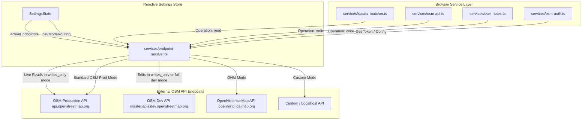

# Requirements

### Overview & Goals
The objective is to introduce a flexible, extensible **Multi-Endpoint and Developer Mode Configuration System** to `browsm`. This allows mappers and developers to switch between different OpenStreetMap-compatible backends:
1. **OpenStreetMap Production** (`api.openstreetmap.org`): The standard live database.
2. **OpenStreetMap Dev / Sandbox API** (`master.apis.dev.openstreetmap.org`): A safe testing ground for experimenting with changesets, POI creation, and note workflows without altering production map data.
3. **OpenHistoricalMap** (`openhistoricalmap.org`): The historical mapping platform sharing the OSM API 0.6 and OAuth2 architecture.
4. **Custom API Endpoints**: User-configured URLs (such as local Rails port dev servers or regional OSM deployments).

### Granular Developer Mode (Read / Write Splitting)
A critical innovation of this feature is **Granular Developer Mode Routing**:
- **Disabled (Live Production)**: Reads and writes interact directly with live OpenStreetMap.
- **Writes Only (Sandbox Edits with Live Data)**: Reads (bounding-box element queries, existing POIs, search) query the rich live OpenStreetMap production database, while all writes (changeset creation, node creation/updates, note submissions) are routed safely to the OSM Dev API sandbox. This enables authentic end-to-end testing against real-world POIs without polluting the production map.
- **Full Dev Mode (Reads & Writes)**: Both reads and writes interact exclusively with the OSM Dev API sandbox.

### Queue Recommendation: Implement Before Phase 5
**Recommendation: Implement this feature immediately before Phase 5.**
- **Immediate Sandbox Testing for Phase 5**: Phase 5 builds the **Tag Comparison Matrix**, changeset comment modal, and live commit workflows. Having Developer Mode ready allows developers to immediately test real changeset creation and node updates against the live OSM Dev server during Phase 5 implementation without risking production edits.
- **Architectural Continuity**: Authentication and API services were just built in Phase 4. Parameterizing them now to support endpoint resolution and per-target token storage avoids having to refactor Phase 5 components later.
- **Zero-Friction Test Automation**: Establishes sandbox endpoints that Playwright E2E tests (Phase 6) can target directly.

### Scope
- **In Scope**:
  - Endpoint presets for OSM Production, OSM Dev Server (`master.apis.dev.openstreetmap.org`), OpenHistoricalMap, and custom endpoint configurations.
  - Granular Developer Mode routing (`disabled`, `writes_only`, `reads_and_writes`).
  - Isolated token management per endpoint in `browser.storage.local`.
  - Extensible Options page (`src/entrypoints/options/`) and Sidebar quick-settings modal.
  - Per-endpoint Sign In / Sign Out controls.
  - Visual environment status badges in the Sidebar and Popup.
  - Mozilla Add-on Policy compliance for declared host permissions (`https://*.openhistoricalmap.org/*`).
- **Out of Scope**:
  - Custom vector tile rendering for OHM historical epochs (vector map tiles continue using standard OpenFreeMap basemaps with historical POI overlays).
  - Bulk changeset migration between environments.

### User Stories
- **Story 1 (Extension Developer / QA)**: As a developer working on Browsm, I want to enable "Dev Mode (Writes Only)" so I can search and inspect real-world POIs from live OSM while testing changeset submissions safely against the OSM Dev server.
- **Story 2 (OpenHistoricalMap Contributor)**: As an OHM mapper, I want to switch the active endpoint to OpenHistoricalMap and sign in with my OHM account so I can map historical businesses directly from web sources.
- **Story 3 (Mapper Settings Management)**: As an OSM mapper, I want an accessible settings interface where I can manage my API endpoints, log into multiple environments independently, and configure future extension preferences.

# Technical Design

### Current Implementation Context
- **Authentication (`src/services/osm-auth.ts`)**: Implements client-side OAuth 2.0 PKCE against hardcoded `https://www.openstreetmap.org/oauth2/*` URLs and stores credentials under a single storage key `browsm_osm_auth_state`.
- **API Services (`src/services/osm-api.ts`, `src/services/osm-notes.ts`)**: Implements XML serialization and HTTP calls using default `https://api.openstreetmap.org/api/0.6`.
- **Spatial Matcher (`src/services/spatial-matcher.ts`)**: Queries `https://api.openstreetmap.org/api/0.6/map?bbox=...` for bounding-box POI retrieval.
- **Sidebar & Popup (`src/entrypoints/sidebar/Sidebar.svelte`, `src/entrypoints/popup/App.svelte`)**: Displays live auth state via `AuthHeader.svelte` without endpoint indicators.

### Key Technical Decisions
- **Decision 1: Per-Endpoint Token Isolation**:
  - *Choice*: Store authentication tokens in `browser.storage.local` keyed by endpoint identifier (`browsm_auth_<endpointId>`).
  - *Rationale*: Allows users to stay logged into OSM Production, OSM Dev, and OHM simultaneously without logging out or overwriting session tokens when switching modes.
- **Decision 2: Centralized Dynamic Endpoint Resolver**:
  - *Choice*: Implement `resolveApiEndpoint(operationType: 'read' | 'write')` in `src/services/endpoint-resolver.ts`.
  - *Rationale*: Decouples calling services (`spatial-matcher.ts`, `osm-api.ts`, `osm-notes.ts`) from hardcoded URLs and cleanly enforces the `writes_only` split-routing logic in a single, testable utility.
- **Decision 3: Dedicated Options Page + Sidebar Modal**:
  - *Choice*: Provide a standard WebExtension options page (`src/entrypoints/options/`) for detailed configuration and a lightweight drawer/modal in the sidebar.
  - *Rationale*: Adheres to browser extension UX conventions while allowing quick environment switching without leaving the active mapping task.
- **Decision 4: Manifest Host Permissions Expansion**:
  - *Choice*: Add `https://*.openhistoricalmap.org/*` to `host_permissions` in `wxt.config.ts`.
  - *Rationale*: Dev API (`master.apis.dev.openstreetmap.org`) is already matched by `https://*.openstreetmap.org/*`. OHM requires explicit declaration under Mozilla's least-privilege review guidelines.

### Architecture Diagram


### Data Models & Contracts (`src/types/settings.ts`)

```typescript
export type EndpointPreset = 'osm-prod' | 'osm-dev' | 'openhistoricalmap' | 'custom';

export type DevModeRouting = 'disabled' | 'writes_only' | 'reads_and_writes';

export interface EndpointConfig {
  id: string;
  name: string;
  description: string;
  apiBaseUrl: string;
  authUrl: string;
  tokenUrl: string;
  webUrl: string;
  clientId: string;
  scopes: string[];
}

export interface SettingsState {
  activeEndpointId: EndpointPreset | string;
  devModeRouting: DevModeRouting;
  customEndpoint?: EndpointConfig;
  defaultChangesetCommentPrefix?: string;
  preferredEditor: 'id' | 'rapid' | 'josm';
}

export interface ResolvedEndpoint {
  config: EndpointConfig;
  token?: OsmAuthToken;
  isDevMode: boolean;
  routingMode: DevModeRouting;
}
```

### Preset Definitions

| Preset ID | Name | API Base URL | OAuth Auth URL | Web URL |
| :--- | :--- | :--- | :--- | :--- |
| `osm-prod` | OpenStreetMap (Live) | `https://api.openstreetmap.org/api/0.6` | `https://www.openstreetmap.org/oauth2/authorize` | `https://www.openstreetmap.org` |
| `osm-dev` | OSM Dev Server | `https://master.apis.dev.openstreetmap.org/api/0.6` | `https://master.apis.dev.openstreetmap.org/oauth2/authorize` | `https://master.apis.dev.openstreetmap.org` |
| `openhistoricalmap` | OpenHistoricalMap | `https://www.openhistoricalmap.org/api/0.6` | `https://www.openhistoricalmap.org/oauth2/authorize` | `https://www.openhistoricalmap.org` |
| `custom` | Custom Instance | *User Defined* | *User Defined* | *User Defined* |

### Risks & Mitigations
- **Risk 1: Accidental Production Writes**: A user intending to test against Dev API might accidentally commit to live OSM if routing state is unclear.
  - *Mitigation*: Prominently display high-visibility, color-coded badges in the sidebar/popup headers (orange for `DEV: WRITES ONLY`, red for `DEV: FULL`, purple for `OHM`), and include the target server URL in the changeset commit modal.
- **Risk 2: Mismatched Element IDs in "Writes Only" Mode**: An element ID on production OSM may not exist on the Dev server when attempting to update it.
  - *Mitigation*: In `writes_only` mode, the client detects when an existing production node is being updated and provides a clear explanatory prompt or automatically stages it as a test node creation on the dev server.

# UI & UX Specifications

### Settings UI Structure & Interaction Flow

The settings system is delivered through two coordinated surfaces:
1. **Full Options Page (`src/entrypoints/options/Options.svelte`)**: Dedicated browser tab opened via extension settings or sidebar link.
2. **Sidebar Quick-Settings Drawer**: Embedded overlay in `Sidebar.svelte` accessible via a gear icon in the header for fast switching during mapping.

### Section Breakdown in Settings

#### 1. API Target & Environment Selector
- **Preset Radio Grid**: Cards for **OpenStreetMap (Live)**, **OpenStreetMap Dev Server (Sandbox)**, and **OpenHistoricalMap**.
- **Custom Endpoint Section**: Expandable form to enter custom `API Base URL`, `OAuth Authorize URL`, `Token URL`, and `Client ID` (with URL format validation).

#### 2. Developer Mode & Safe Sandbox Routing
- **Dev Mode Routing Options**:
  - 🟢 **Disabled (Live Production)**: Reads and writes target the live OpenStreetMap database.
  - 🟠 **Writes Only (Safe Sandbox)**: Read POIs and search live OSM; route all changesets, node edits, and map notes to `master.apis.dev.openstreetmap.org`.
  - 🔴 **Full Dev Mode (Isolated Sandbox)**: Both reads and writes target the OSM Dev sandbox exclusively.

#### 3. Account & Authentication Manager (Per Endpoint)
- Displays current login status for each configured endpoint.
- For each endpoint card:
  - If authenticated: Shows user avatar, username, account creation date, and `Log Out` button.
  - If unauthenticated: Shows `Sign In with [Endpoint Name]` button.
- Eliminates the need to switch back and forth just to verify credentials.

#### 4. Environment Visual Badges & Status Indicators
- **Sidebar & Popup Header Badges**:
  - Live OSM: Subtle neutral or green status indicator.
  - Dev Mode (Writes Only): Bold amber badge `[DEV API: WRITES ONLY]` with tooltip explaining that live data is read and test edits are sent to sandbox.
  - Full Dev Mode: Bold red badge `[DEV API: FULL]`.
  - OpenHistoricalMap: Violet badge `[OpenHistoricalMap]`.
- **Commit Confirmation Modal**: Displays explicit target server banner (e.g. `Target: master.apis.dev.openstreetmap.org`) before any changeset is uploaded.

### Accessibility & Theming
- Fully compatible with automatic Dark / Light mode switching.
- High-contrast badge colors meeting WCAG 2.1 AA ratios.
- Full keyboard tab navigation across all radio cards, inputs, and action buttons.

# Testing Strategy

### Validation Approach
Verification combines deterministic unit tests for endpoint routing logic with component tests for the settings UI and token lifecycle.

### Key Scenarios

#### Scenario 1: Split Read/Write Routing ("Writes Only" Dev Mode)
- **Input**: Set `activeEndpointId = 'osm-prod'` and `devModeRouting = 'writes_only'`.
- **Expected Outcome**:
  - Calling `resolveApiEndpoint('read')` returns `https://api.openstreetmap.org/api/0.6`.
  - Calling `resolveApiEndpoint('write')` returns `https://master.apis.dev.openstreetmap.org/api/0.6` with the Dev API access token.
  - Bounding box search queries live OSM; changeset creation submits to Dev API.

#### Scenario 2: Per-Endpoint Token Isolation
- **Input**: User logs into OpenStreetMap Live, then switches to OSM Dev and logs into a test account.
- **Expected Outcome**:
  - `browser.storage.local` stores separate auth records (`browsm_auth_osm-prod` and `browsm_auth_osm-dev`).
  - Switching between endpoints restores the respective user profile and token without prompting re-authentication.

#### Scenario 3: OpenHistoricalMap Integration
- **Input**: User selects OpenHistoricalMap preset and initiates login.
- **Expected Outcome**:
  - OAuth authorization redirects to `https://www.openhistoricalmap.org/oauth2/authorize`.
  - User details are fetched from `https://www.openhistoricalmap.org/api/0.6/user/details`.
  - Sidebar badge reflects OpenHistoricalMap.

#### Scenario 4: Custom Endpoint Validation & Fallback
- **Input**: User inputs invalid URL in custom endpoint form.
- **Expected Outcome**:
  - Inline validation error appears; form cannot be saved until valid HTTPS/HTTP URLs are provided.
  - Reset button restores default production settings.

### Unit & Component Tests to Implement
- `tests/unit/settings-store.test.ts`: Settings persistence, preset loading, and reactive subscriptions.
- `tests/unit/endpoint-resolver.test.ts`: Routing matrix covering all combinations of endpoint presets and `DevModeRouting` flags.
- `tests/unit/osm-auth-multi.test.ts`: Isolated token storage and multi-endpoint login orchestration.
- `tests/unit/options-page.test.ts`: Svelte 5 component tests verifying settings UI interactions and badge rendering.

# Delivery Steps

### ✓ Step 1: Endpoint Presets, Settings Data Models & Manifest Host Permissions
The core data types and configurations in `src/types/auth.ts`, `src/types/settings.ts`, and `wxt.config.ts` are updated to support multi-target OSM/OHM endpoints, granular Developer Mode routing, and per-endpoint token isolation.

- Define `EndpointPreset` ('osm-prod' | 'osm-dev' | 'openhistoricalmap' | 'custom'), `DevModeRouting` ('disabled' | 'writes_only' | 'reads_and_writes'), `EndpointConfig`, and `SettingsState` interfaces in `src/types/settings.ts`.
- Expand preset registry with official URLs, OAuth endpoints, and scopes for OpenStreetMap Production, OpenStreetMap Dev API (`master.apis.dev.openstreetmap.org`), and OpenHistoricalMap (`openhistoricalmap.org`).
- Update `wxt.config.ts` permissions to declare `https://*.openhistoricalmap.org/*` in `host_permissions` alongside existing OSM and Nominatim domains in full accordance with Mozilla Add-on Policies.
- Write unit tests in `tests/unit/settings-types.test.ts` verifying default presets, endpoint URL sanitization, and fallback values.

### ✓ Step 2: Multi-Target OAuth Service, Token Isolation & Dynamic Endpoint Resolver
The authentication and API services are refactored to support endpoint switching, per-endpoint token storage, and dynamic read/write split routing.

- Update `src/services/osm-auth.ts` to store and retrieve authentication states per endpoint ID in `browser.storage.local` (e.g. `browsm_auth_<endpointId>`), preventing account conflicts across environments.
- Update `src/services/osm-api.ts` and `src/services/osm-notes.ts` to accept dynamic target API endpoints and pass corresponding access tokens automatically.
- Implement endpoint routing resolver in `src/services/endpoint-resolver.ts` that determines the correct API base URL and token depending on operation type (`read` vs. `write`) and `DevModeRouting` state (`writes_only` routes reads to production and writes to dev server; `reads_and_writes` routes both to dev server).
- Create reactive `src/stores/settings.svelte.ts` managing endpoint selection, developer mode, and custom configurations with persistent `browser.storage.local` backing.
- Write unit tests in `tests/unit/endpoint-resolver.test.ts` and `tests/unit/osm-auth-multi.test.ts` validating split read/write routing and isolated token storage.

### ✓ Step 3: Options Page & Sidebar Quick-Settings Interface
A dedicated options page and a sidebar/popup quick-settings panel provide user controls for endpoint selection, developer mode toggles, and per-endpoint login/logout.

- Create `src/entrypoints/options/` with `index.html`, `main.ts`, and `Options.svelte` featuring a clean, accessible settings dashboard.
- Build endpoint selector with one-click presets for OpenStreetMap, OSM Dev Server, and OpenHistoricalMap, plus expandable custom endpoint URL inputs.
- Implement Developer Mode toggle group with clear descriptions: Disabled (Production), Writes Only (Sandbox Edits with Live POI Reads), and Full Dev Mode (Dev Reads + Dev Writes).
- Integrate per-endpoint authentication cards showing current login status, username, avatar, and 1-click Sign In / Sign Out buttons for each target.
- Add quick Settings modal button (gear icon) in `Sidebar.svelte` and `App.svelte` header for instant access without leaving the active mapping context.
- Write component tests in `tests/unit/options-page.test.ts` verifying reactive state updates, preset selection, and login/logout trigger dispatches.

### ✓ Step 4: Visual Environment Badges, Integration Verification & Documentation
The sidebar and popup display high-visibility environment badges, and documentation is updated to guide developers and mappers.

- Add dynamic environment status badge in `Sidebar.svelte` and `App.svelte` headers (e.g., orange `[DEV: WRITES ONLY]`, red `[DEV: FULL]`, purple `[OPENHISTORICALMAP]`, or neutral for production) with explanatory tooltips.
- Update `AuthHeader.svelte` to reflect the active target endpoint and prompt for login against the specific active target when unauthenticated.
- Update `README.md`, `FEATURES.md`, `documentation/user_guide.md`, and `documentation/developer_api.md` with configuration guides for Developer Mode, OSM Dev sandbox testing, and OpenHistoricalMap.
- Run `npm run check` and `npm test` across all unit, component, and integration suites to ensure 100% test pass rate.